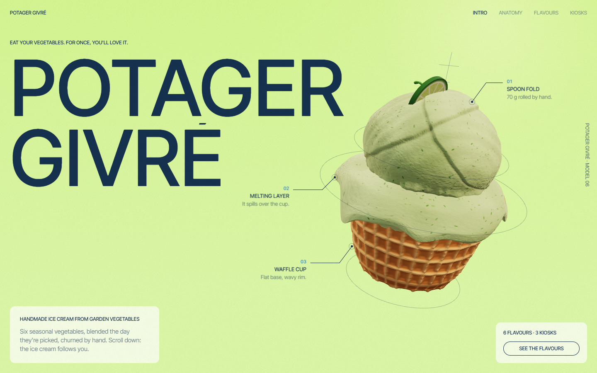

# Potager Givré

A one-page showcase site for **Potager Givré**, a fictional brand of vegetable ice cream. Portfolio project.



## What's in it

- A 3D ice cream built entirely in code with Three.js: a waffle cup, a melting layer, and a different scoop and topping for each of the six flavours.
- Scroll choreography: the ice cream moves, turns and opens up into an exploded view as you scroll, with smoothed wheel scrolling and inertia.
- Six flavours (avocado, garden pea, carrot, sweet potato, beetroot, tomato). Each flavour has its own background colour, a graphic shape and floating 3D ingredients, plus nutrition facts and a full-screen step-by-step recipe.
- Works on mobile and respects reduced motion.

Everything lives in a single `index.html`. Three.js 0.170 loads from a CDN, and there is no build step.

## Run it locally

Open `index.html` in a browser, or serve the folder:

```bash
npx serve .
```

Fictional brand, demo project. The newsletter form does not send anything.
